<div align="center">


<a href="https://github.com/joaohugo89">
  
</a>

<p>
  <a href="https://joaohugo.com"></a>
  <a href="https://github.com/joaohugo89"></a>
  <a href="https://freelancer.joaohugo.com"></a>
  <a href="https://www.linkedin.com/in/joao-hugo-soares-de-campos"></a>
</p>

</div>


I'm a Computer Engineer graduated from **UNIFEI**, interested in building reliable applications and turning ideas into useful software.

```yaml
focus:     backend services · REST APIs · full-stack applications
cloud:     AWS  # currently going deeper here
craft:     clean architecture · maintainable code · testing · application design
edge:      cybersecurity background brought into everyday development
building:  JH Comp — websites, systems & tech support for small businesses
```


<!-- Cards gerados automaticamente por .github/workflows/update-cards.yml — não edite à mão -->
<!-- PROJECTS:START -->
<!-- PROJECTS:END -->

<details>
<summary><b>⚡ Websites & digital experiences</b></summary>
<br />

| Project | |
|---|---|
| [Veterinary Clinic Website](https://github.com/joaohugo89/clinica-veterinaria) | Client website |
| [Nutritionist Website](https://github.com/joaohugo89/Nutricionista) | Client website |
| [Lawyer Website](https://github.com/joaohugo89/Advogado) | Client website |
| [ForceGym](https://github.com/joaohugo89/forcegym) | Gym website |
| [Personal Website](https://github.com/joaohugo89/personal) | Personal site |
| [Pokédex](https://github.com/joaohugo89/Pokedex) | API-driven frontend |

</details>


<div align="center">

**JH Comp** is my own business — *integrated solutions in hardware and software*.<br />
I build websites and systems for small businesses, and offer hands-on technical support for computers.

</div>

<table>
  <tr>
    <td width="50%" align="center">
      <a href="https://freelancer.joaohugo.com"></a>
    </td>
    <td width="50%" align="center">
      <a href="https://tech.joaohugo.com"></a>
    </td>
  </tr>
</table>

<div align="center">
  <a href="mailto:contato@joaohugo.com"></a>
  <a href="https://instagram.com/jh.comp"></a>
</div>


<div align="center">

<sub><b>BACKEND</b></sub><br />


<sub><b>FRONTEND</b></sub><br />


<sub><b>DATA · CLOUD · TOOLS</b></sub><br />


</div>


<div align="center">
  
  
</div>


<div align="center">

When I'm not shipping JH Comp work, I'm live as **JoaoHugo.exe** — rebuilding the *Astral Sorcery* Minecraft mod for modern NeoForge, by hand, with a strict **no-AI-in-code** rule.

<a href="https://twitch.tv/joaohugo_exe"></a>
<a href="https://kick.com/joaohugo-exe"></a>
<a href="https://youtube.com/@joaohugo_exe"></a>

</div>


